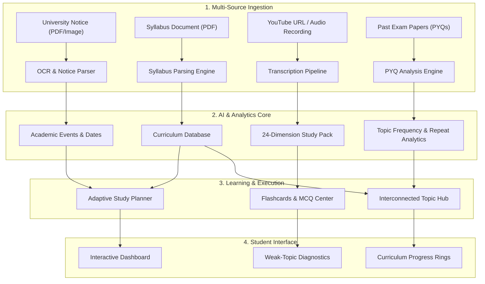

<div align="center">

# 🎓 CSE Study Hub
### *AI-Powered Academic Intelligence & Exam Management Platform for Computer Science Engineers*

[](https://cse-study-hub-9u1y.onrender.com)
[](https://github.com/mkumari02706-cloud/cse-study-hub)
[](https://nodejs.org/)
[](https://expressjs.com/)
[](https://ai.google.dev/)
[](LICENSE)

<br/>

**Transform fragmented syllabi, disorganized lecture recordings, and past exam papers into an interactive, structured, AI-guided preparation ecosystem.**

[Explore Live Demo](https://cse-study-hub-9u1y.onrender.com) • [Report Issue](https://github.com/mkumari02706-cloud/cse-study-hub/issues) • [View Architecture](#-project-architecture)

</div>

---

## 📖 Table of Contents
- [Project Overview](#-project-overview)
- [Problem Statement](#-problem-statement)
- [Our Solution](#-our-solution)
- [Key Features](#-key-features)
- [How It Works](#-how-it-works)
- [Technology Stack](#-technology-stack)
- [Project Architecture](#-project-architecture)
- [Installation & Setup](#-installation--setup)
- [Environment Variables](#-environment-variables)
- [How to Run Locally](#-how-to-run-locally)
- [Deployment Guide (Render)](#-deployment-guide-render)
- [Live Demo](#-live-demo)
- [Screenshots](#-screenshots)
- [Future Improvements](#-future-improvements)
- [Contributing](#-contributing)
- [License](#-license)

---

## 🌟 Project Overview

**CSE Study Hub** is a full-stack, AI-driven educational platform engineered specifically for **Computer Science & Engineering (CSE)** undergraduate students. College curriculums require mastering complex theoretical computer science concepts, heavy programming paradigms, and rigorous mathematical foundations across fast-paced semesters.

CSE Study Hub serves as a central cockpit for academic lifecycle management. It parses official university syllabus documents, extracts topics and units, transcribes classroom lectures and YouTube playlists into structured 24-dimension study packs, mines past examination papers (PYQs) for recurring question patterns, ingests university examination circulars via OCR, and automatically builds personalized, adaptive study timetables.

---

## ⚠️ Problem Statement

Computer Science Engineering students face severe friction in academic preparation:

1. **Information Fragmentation:** Syllabi exist in dense PDFs, lecture recordings are scattered across YouTube or drive links, and exam papers are passed down as low-quality scans.
2. **Passive Video Learning:** Watching 2-hour video lectures without organized summaries, code samples, or flashcards leads to rapid forgetting (the *Ebbinghaus Forgetting Curve*).
3. **Unpredictable Exam Preparation:** Students struggle to identify which topics carry high mark distributions or repeat across consecutive university exam cycles.
4. **Timetable Clashes & Late Revision:** Official exam circulars are released just weeks before exams; students lack dynamic scheduling tools to calculate daily required study hours based on exact notice dates.

---

## 💡 Our Solution

**CSE Study Hub** solves academic fragmentation with an interconnected, AI-augmented workflow:

* **Ingest & Parse:** Upload raw syllabus PDFs and university exam notices to auto-generate structured subject databases and academic calendar events.
* **Transcribe & Synthesize:** Convert any YouTube URL or uploaded lecture recording into a comprehensive **24-Dimension Academic Study Pack** (detailed explanations, cheat-sheets, formulas, flashcards, and MCQs).
* **Analyze & Predict:** Use intelligent text mining on Previous Year Questions (PYQs) to calculate question frequency and highlight **High-Yield / Must-Prepare** topics.
* **Plan & Adapt:** Link university notice exam dates to an automated spaced-revision study planner that auto-balances daily task workloads based on remaining calendar days.
* **Track & Master:** Monitor topic-level completion checklists, practice interactive quizzes with instant explanations, and target weak areas with built-in diagnostic matrices.

---

## 🚀 Key Features

### 1. 📅 AI-Powered Study Planner
* Generates balanced preparation timetables tailored to your remaining preparation days and target daily hours.
* Automatically incorporates daily revision slots and spaced learning intervals.
* Complete lifecycle management: check off completed tasks, edit allocated hours, reschedule overdue tasks, or cancel/purge obsolete plans.

### 2. 📄 University Syllabus Explorer
* Intelligent multi-engine syllabus parser (combining rule-based heuristics and Google Gemini multimodal AI).
* Multi-semester curriculum management supporting Semesters 1 through 8.
* Duplicate subject code prevention and protection for core foundational subjects.

### 3. 🎯 Subject & Unit-Wise Topic Tracking
* Deep curriculum breakdown across core CSE subjects (OOPS with Java, DSA with Java, Operating Systems, Discrete Mathematics, Digital Electronics, and custom electives).
* Interactive progress tracking per topic with instant completion percentage meters and progress rings.

### 4. 🔗 YouTube Lecture URL Transcription
* One-click ingestion of educational YouTube videos and playlists.
* Automated video ID extraction supporting standard YouTube URLs, short URLs (`youtu.be`), Shorts, and embed links.
* Direct captions extraction converted into structured, readable transcripts.

### 5. 🎙️ Video / Audio Lecture Upload & Transcription
* Direct multipart upload support for local lecture audio and video files (`.mp3`, `.mp4`, `.wav`, `.webm`, `.m4a`).
* Robust file validation, size limits (up to 50MB), and automated media processing into study notes.

### 6. 📑 AI-Based PYQ Analysis & Repeat Detection
* Upload scanned or typed university examination papers.
* Automatically extracts question text, allocated marks, unit classification, and Bloom's Taxonomy cognitive level.
* Detects repeated questions across historical years with similarity scoring and historical evidence logging.

### 7. 🔥 Important Topics Identification (Interconnected Topic Hub)
* Ranks syllabus topics into **🔥 High Yield / Must Prepare**, **⚖️ Moderate Frequency**, and **📘 Low Frequency**.
* Cross-links syllabus topics directly to relevant past exam questions, lecture notes, and practice flashcards.

### 8. 🏛️ University Notice Upload & OCR Engine
* Upload scanned university notices, exam date sheets, and academic circulars (PDFs and images).
* Intelligent OCR extracts university names, examination sessions, affected semesters, and branch-specific paper schedules.
* Two-step verification: preview extracted examination dates, edit if necessary, and confirm into the master database.

### 9. ⏱️ Personalized Study Planning Based on Notices & Exam Dates
* Automatically converts confirmed university notice exam dates into countdown deadlines.
* Generates milestone-driven study tasks backwards from the exact examination date.
* Automatically reschedules preparation tasks if the university issues a revised examination schedule.

### 10. 📈 Learning Progress Tracker & Weak-Topic Diagnostics
* Global curriculum dashboard measuring overall semester completion percentage.
* Diagnostic matrix identifying weak topics based on practice quiz and mock exam scores.
* Dynamic category filtering by semester, subject, and completion status.

### 11. 📊 Unified Real-Time Dashboard
* Comprehensive cockpit displaying subject progress cards, active study goals, upcoming examination deadlines, and quick navigation shortcuts.
* Dark / Light mode UI built with responsive CSS grid and modern typography.

---

## 🔄 How It Works



---

## 💻 Technology Stack

### Backend & Server
* **Runtime:** Node.js (v18.0.0+ / v20 LTS recommended)
* **Web Framework:** Express.js 5.3.0
* **View Engine:** EJS 7.0.2 (Server-Side Rendering with modular partials)
* **File Upload Handling:** Multer 2.5.0
* **PDF Processing:** `pdf-parse` 1.1.1
* **YouTube Processing:** `youtube-transcript` 1.3.1
* **Environment Configuration:** `dotenv` 18.0.10

### Frontend & UI
* **Styling:** Custom Vanilla CSS3 with Modern CSS Custom Properties (Theme tokens)
* **Typography:** Inter & JetBrains Mono (via Google Fonts)
* **Components:** Custom interactive Flashcard deck, MCQ Quiz engine with instant scoring, modal dialogs, and responsive sidebar navigation
* **Client-Side Scripting:** Vanilla ES6+ JavaScript (`public/js/main.js`, `addLecture.js`, `pyq.js`, `noteViewer.js`)

### Artificial Intelligence & Processing
* **Primary LLM:** Google Gemini REST API (`gemini-3.5-flash-lite`, `gemini-flash-latest`, `gemini-2.5-flash`)
* **Fallback LLM:** OpenAI API (`gpt-4o-mini`)
* **Parsing Engine:** Hybrid Architecture (Rule-based Regex Heuristics + Multimodal AI Grounding)

### Storage & Persistence
* **Data Layer:** Mongoose-compatible JSON-backed ORM (`src/models/baseModel.js`)
* **Optional Cloud DB:** MongoDB Atlas connection support (`MONGODB_URI`)
* **Static Assets:** Clean uploads folder structure with `.gitkeep` preservation

---

## 🏛️ Project Architecture

```
CSE-Study-Hub/
├── .env.example                     # Environment template (Safe placeholder values)
├── .gitignore                       # Production gitignore (Excludes .env, uploads, node_modules)
├── package.json                     # Project manifest and scripts
├── package-lock.json                # Locked dependency tree
├── render.yaml                      # Infrastructure blueprint for 1-click Render deployment
├── server.js                        # Express server entry point (Host: 0.0.0.0, PORT)
├── test.js                          # 32 Comprehensive regression tests
├── test_functionality_audit.js      # 6 End-to-end functionality audit verifications
│
├── data/                            # Persistent JSON database collections
│   ├── academic_events.json         # Exam schedules and academic milestones
│   ├── custom_subjects.json         # User-added custom subjects
│   ├── explore_progress.json        # Career roadmap milestone progress
│   ├── learning_progress.json       # Lecture & transcript completion status
│   ├── lecture_notes.json           # Synthesized 24-dimension study packs
│   ├── lecture_transcripts.json     # Saved lecture transcriptions
│   ├── library.json                 # Saved library materials
│   ├── planner.json                 # Daily goals and spaced timetable
│   ├── practice.json                # Quiz history & weak-topic matrices
│   ├── progress.json                # Subject curriculum topic checklists
│   ├── pyqs.json                    # Analyzed exam questions & frequency ranks
│   ├── study_plans.json             # AI-generated multi-week study schedules
│   ├── study_tasks.json             # Individual actionable study tasks
│   └── university_notices.json      # OCR-parsed examination circulars
│
├── public/                          # Static public assets
│   ├── css/style.css                # Global theme styling, layouts, and animations
│   └── js/                          # Client-side UI scripts
│       ├── addLecture.js            # Multipart file & URL upload client
│       ├── main.js                  # Global modals, theme toggles, and checklists
│       ├── noteViewer.js            # Study pack reader & print handler
│       └── pyq.js                   # Interactive PYQ filters and repeat tags
│
├── src/                             # Backend application core
│   ├── config/
│   │   └── subjects.js              # 5 Core CSE subjects and unit curriculum definitions
│   ├── models/                      # ODM model definitions
│   │   ├── AcademicEvent.js
│   │   ├── baseModel.js             # Mongoose-compatible file storage engine
│   │   ├── index.js
│   │   ├── LearningProgress.js
│   │   ├── LectureNotes.js
│   │   ├── LectureTranscript.js
│   │   ├── StudyPlan.js
│   │   ├── StudyTask.js
│   │   └── UniversityNotice.js
│   ├── routes/                      # Modular Express route handlers
│   │   ├── assistantRoutes.js       # AI Chatbot, code dry-run, and PDF QA
│   │   ├── exploreRoutes.js         # 8 Career Roadmaps & milestone endpoints
│   │   ├── indexRoutes.js           # Dashboard, global search, and home routes
│   │   ├── lectureRoutes.js         # Lecture upload & markdown reader routes
│   │   ├── libraryRoutes.js         # Saved notes library and deletion
│   │   ├── noticeRoutes.js          # Notice upload, OCR, and event endpoints
│   │   ├── plannerRoutes.js         # Plan generation, task toggle, and rescheduling
│   │   ├── practiceRoutes.js        # MCQs, flashcards, and diagnostic endpoints
│   │   ├── progressRoutes.js        # Curriculum progress calculation endpoints
│   │   ├── pyqRoutes.js             # PYQ analysis and topic frequency endpoints
│   │   ├── subjectRoutes.js         # Subject details & topic hub routes
│   │   ├── syllabusRoutes.js        # PDF syllabus upload and parser routes
│   │   └── transcriptionRoutes.js   # Lecture transcriptions & study pack generation
│   └── services/                    # Business logic & AI services
│       ├── aiService.js             # Gemini REST API caller, prompts & study pack generators
│       ├── exploreService.js        # 8 Domain roadmaps & milestone storage
│       ├── fileService.js           # Disk file management & template loaders
│       ├── noticeService.js         # Notice OCR & event generation
│       ├── plannerService.js        # AI study schedule calculation engine
│       ├── practiceService.js       # MCQ generator, flashcards, and weak-topic matrix
│       ├── progressService.js       # Curriculum completion calculator
│       ├── pyqService.js            # Question frequency analyzer & repeat detector
│       ├── syllabusService.js       # Heuristic syllabus text parser
│       ├── topicInterconnectService.js # Cross-module topic linking
│       ├── transcriptionService.js  # Audio/video transcription orchestrator
│       └── youtubeService.js        # YouTube ID extractor & caption fetcher
│
├── templates/                       # Markdown scaffolds
│   ├── NOTE_TEMPLATE.md
│   ├── PYQ_TEMPLATE.md
│   ├── REVISION_TEMPLATE.md
│   └── TRANSCRIPT_TEMPLATE.md
│
├── uploads/                         # Temporary file staging directory
│   ├── .gitkeep
│   └── subjects/.gitkeep
│
└── views/                           # Server-rendered EJS templates
    ├── pages/                       # Route views
    │   ├── 404.ejs                  # Custom 404 error page
    │   ├── add-lecture.ejs          # Upload lecture view
    │   ├── assistant.ejs            # AI Study Assistant view
    │   ├── dashboard.ejs            # Master dashboard view
    │   ├── error.ejs                # 500 Server error view
    │   ├── explore.ejs              # Career roadmaps gallery
    │   ├── explore-detail.ejs       # Individual roadmap view
    │   ├── library.ejs              # Saved materials library
    │   ├── note-detail.ejs          # Full study pack viewer
    │   ├── note-print.ejs           # Clean printable cheat-sheet view
    │   ├── notices.ejs              # University notice upload & OCR view
    │   ├── notices-detail.ejs       # Notice details & confirmed events
    │   ├── planner.ejs              # Study planner & timetable view
    │   ├── practice.ejs             # Practice center portal
    │   ├── practice-flashcards.ejs  # Interactive flashcard deck
    │   ├── practice-quiz.ejs        # Interactive MCQ quiz session
    │   ├── progress.ejs             # Master progress analytics
    │   ├── pyqs.ejs                 # PYQ analysis portal
    │   ├── pyq-analytics.ejs        # PYQ repeat frequency analytics view
    │   ├── pyq-detail.ejs           # Paper question breakdown
    │   ├── search.ejs               # Cross-curriculum search results
    │   ├── subject.ejs              # Core subject unit view
    │   ├── syllabus-upload.ejs      # Syllabus PDF upload & preview
    │   ├── transcription.ejs        # Transcription workspace
    │   └── transcription-detail.ejs # Complete 24-Dimension Pack viewer
    └── partials/                    # Reusable components
        ├── footer.ejs
        ├── header.ejs
        ├── navbar.ejs
        └── sidebar.ejs
```

---

## 🛠️ Installation & Setup

### Prerequisites
* **Node.js:** v18.0.0 or higher ([Download Node.js](https://nodejs.org/))
* **Git:** Installed on your local machine ([Download Git](https://git-scm.com/))
* **Google Gemini API Key:** An active API key from [Google AI Studio](https://aistudio.google.com/)

### Clone the Repository
```bash
git clone https://github.com/mkumari02706-cloud/cse-study-hub.git
cd cse-study-hub
```

### Install Dependencies
```bash
npm install
```

---

## 🔐 Environment Variables

Create a `.env` file in the root directory by copying the provided `.env.example` template:

```bash
cp .env.example .env
```

Populate the `.env` file with your credentials:

```env
# Server Configuration
PORT=3000
NODE_ENV=development

# Google Gemini API Configuration (Required for AI generation, OCR, and Assistant)
GEMINI_API_KEY=your_gemini_api_key_here
GEMINI_MODEL=gemini-3.5-flash-lite

# Optional: OpenAI API Configuration (Fallback provider)
OPENAI_API_KEY=
OPENAI_MODEL=gpt-4o-mini

# Optional: External Database Connection (If connecting MongoDB Atlas)
# MONGODB_URI=mongodb+srv://<username>:<password>@cluster0.mongodb.net/csestudyhub?retryWrites=true&w=majority
```

> [!CAUTION]
> Never commit your real `.env` file or API keys to GitHub. The project includes a pre-configured `.gitignore` that automatically excludes `.env` and all secret files.

---

## 💻 How to Run Locally

### Start Development Server
```bash
npm start
```
Once started, open your web browser and navigate to:
```
http://localhost:3000
```

### Run the Automated Test Suites
The project includes automated regression tests and end-to-end functionality audits:

```bash
# Run the 32 Regression Tests
npm test

# Run the 6 Comprehensive Functionality Audits
node test_functionality_audit.js
```

---

## ☁️ Deployment Guide (Render)

This repository is pre-configured for zero-friction deployment on [Render](https://render.com) using the included [render.yaml](file:///home/shwati-kumari/CSE-Study-Hub/render.yaml) blueprint.

### Step-by-Step Dashboard Setup:

1. **Sign in to Render:** Open [dashboard.render.com](https://dashboard.render.com/).
2. **Create Web Service:** Click **New +** > **Web Service**.
3. **Connect Repository:** Select `mkumari02706-cloud/cse-study-hub`.
4. **Configure Deployment Settings:**
   * **Name:** `cse-study-hub`
   * **Region:** Any preferred region (e.g., *Singapore*, *Oregon*, or *Frankfurt*)
   * **Branch:** `main`
   * **Runtime:** `Node`
   * **Build Command:** `npm install`
   * **Start Command:** `node server.js`
   * **Instance Type:** `Free`
5. **Set Environment Variables:**
   Under the **Environment** tab, add:
   * `NODE_ENV` = `production`
   * `GEMINI_API_KEY` = *[Your Google Gemini API Key]*
   * `GEMINI_MODEL` = `gemini-3.5-flash-lite`
6. **Click "Deploy Web Service":** Render will install dependencies and start the application on `0.0.0.0:$PORT`.

---

## 🌐 Live Demo

The application is deployed and publicly accessible on Render:

🔗 **[https://cse-study-hub-9u1y.onrender.com](https://cse-study-hub-9u1y.onrender.com)**

---

## 📸 Screenshots

*(Replace placeholder URLs with actual interface captures after taking screenshots)*

| View | Preview |
| :--- | :--- |
| **Unified Dashboard** | `` |
| **Syllabus & Topic Tracking** | `` |
| **PYQ Frequency Analytics** | `` |
| **Complete Academic Study Pack** | `` |
| **Interactive Flashcards & Quizzes** | `` |
| **Study Planner & Timetable** | `` |

---

## 🔮 Future Improvements

- [ ] **Collaborative Study Rooms:** Real-time peer study rooms with synchronized note-taking using WebSockets.
- [ ] **Cloud File Storage Integration:** Native AWS S3 / Cloudinary adapters for persistent PDF and media uploads on serverless hosting.
- [ ] **Automated Lecture Sync:** RSS/YouTube webhook integration to automatically ingest new department lectures into transcripts.
- [ ] **Offline PWA Support:** Progressive Web App capabilities for offline access to generated revision flashcards and cheat-sheets.
- [ ] **Personalized Voice Tutoring:** Interactive voice-based AI tutoring sessions using Google Gemini Live Audio streaming.

---

## 🤝 Contributing

Contributions, issues, and feature requests are welcome!

1. Fork the project repository.
2. Create your feature branch (`git checkout -b feature/AmazingFeature`).
3. Commit your changes (`git commit -m "Add some AmazingFeature"`).
4. Run tests to ensure complete pass rate (`npm test && node test_functionality_audit.js`).
5. Push to the branch (`git push origin feature/AmazingFeature`).
6. Open a Pull Request.

---

## 📜 License

This project is distributed under the **ISC License**. See the `LICENSE` file for details.

---

<div align="center">
  <sub>Built with ❤️ for Computer Science & Engineering students worldwide.</sub>
</div>
